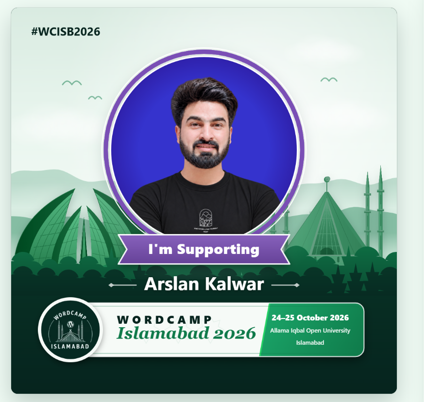
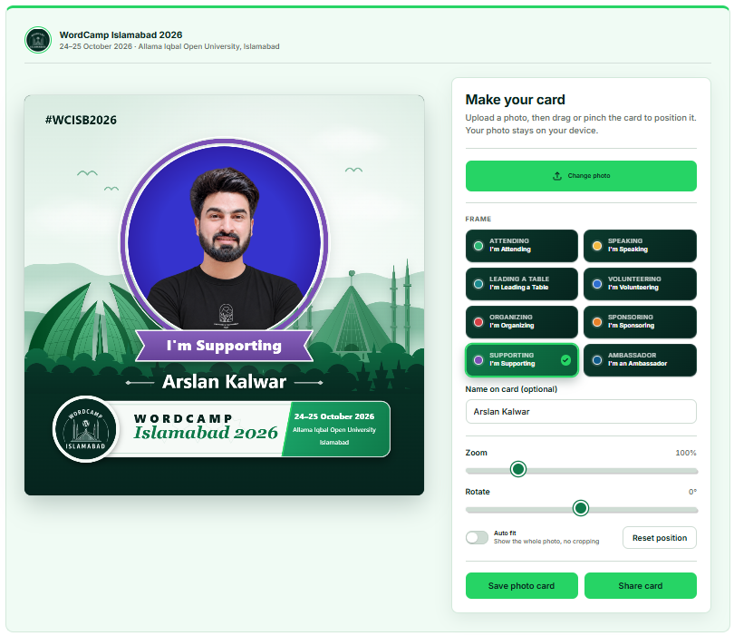

# WordCamp Islamabad Photo Card Maker

[](LICENSE)


A WordPress plugin that lets attendees, speakers, volunteers, organizers, sponsors, table leads and ambassadors create and share a **WordCamp Islamabad 2026** photo card (Contributor Day 24 October, Conference Day 25 October 2026, Allama Iqbal Open University).

<p align="center"></p>



*A finished card (top) and the card maker interface (bottom).*

## Features

- **Private by design.** Photos are processed in the browser only. Nothing is uploaded, stored or tracked.
- **Eight role frames:** Attending, Speaking, Leading a Table, Volunteering, Organizing, Sponsoring, Supporting, Ambassador, each with its own ribbon color.
- **Islamabad artwork:** mint-white sky, misty green Margalla Hills, Pakistan Monument and Faisal Mosque, event logo badge and title plate.
- **Photo tools:** drag, pinch, wheel zoom (0.2×–4×), rotate, **Auto fit** (whole photo, no cropping) and Reset position. Fully keyboard accessible.
- **Save or share:** 1080 × 1080 PNG, or the native share sheet on phones.
- **Shortcode and block:** `[wcisb_photo_card]` and a server-side rendered block.
- **Customizable:** colors, title, date, venue, hashtag, share message, roles, event logo and optional custom frames from Settings.
- **Standards:** WordPress coding and plugin guidelines, WCAG 2.2 AA target, translation ready, RTL friendly, no external requests, no cookies.

## Requirements

WordPress 6.3+ · PHP 7.4+

## Installation

1. Download the latest ZIP from [Releases](../../releases) (or clone this repository into `wp-content/plugins/wc-islamabad-photo-card`).
2. In WordPress go to **Plugins → Add New → Upload Plugin**, choose the ZIP and activate.
3. Review **Settings → WordCamp Photo Card** (upload the official event logo under **Event logo**).
4. Add `[wcisb_photo_card]` to a page, for example `/photo-card`, using the **Shortcode** block, or insert the **WordCamp Photo Card** block.

## Usage

```
[wcisb_photo_card]
[wcisb_photo_card title="Show you're coming" roles="attending,speaking" show_name="no"]
```

| Attribute | Values | Description |
|---|---|---|
| `title` | text | Heading above the controls. |
| `roles` | comma-separated slugs | Limit to these roles: `attending`, `speaking`, `table-lead`, `volunteering`, `organizing`, `sponsoring`, `supporting`, `ambassador`. |
| `show_name` | `yes` / `no` | Show or hide the name field. |

## Developer hooks

```php
// Add or recolor a role.
add_filter( 'wcipc_roles', function ( $roles ) {
	$roles['press'] = array(
		'label'  => __( 'Press', 'my-textdomain' ),
		'ribbon' => __( "I'm covering it", 'my-textdomain' ),
		'color'  => '#8a3ffc',
	);
	return $roles;
} );

// Export size (default 1080).
add_filter( 'wcipc_card_size', fn() => 2160 );
```

All styles are scoped under `.wcipc-app`; override `--wcipc-primary`, `--wcipc-dark` and `--wcipc-accent` for colors.

## Documentation

- [Full documentation](docs/DOCUMENTATION.md): settings, shortcode, block, custom frames, hooks, accessibility, security, troubleshooting, test checklist, FAQ
- [Changelog](CHANGELOG.md)
- [WordPress.org style readme](readme.txt)

## Contributing

Contributions are welcome. Please read [CONTRIBUTING.md](CONTRIBUTING.md) and the [Code of Conduct](CODE_OF_CONDUCT.md). Report security issues privately as described in [SECURITY.md](SECURITY.md).

## Author

[Arslan Kalwar](https://arslankalwar.com/)

## License

GPL-2.0-or-later. See [LICENSE](LICENSE).

"WordPress" and "WordCamp" are trademarks of the WordPress Foundation. This plugin ships text and shapes only, not the official logos; add the event logo yourself in Settings.
